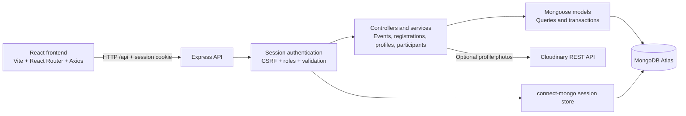

# EventNexus

**Campus events, from discovery to participation.**

EventNexus is a full-stack campus event management platform developed as a software engineering internship project. Students discover events, complete registration forms, and manage participation, while organizers publish events, manage capacity, and review participant records from a dedicated workspace.


[Setup](#getting-started) · [API](#api-overview) · [Testing](#testing) · [Documentation](#technical-documentation)

## Project overview

Campus event participation involves more than publishing a date and venue. Students need clear information and dependable registration records; organizers need accurate capacity and access to submitted participant details. EventNexus brings these tasks into one application.

| Role | Purpose |
| --- | --- |
| **Student** | Discover events, register with academic details and custom answers, and manage a profile and registration history. |
| **Organizer** | Create owned events, configure registration questions, review participants, and manage registrations. |

Public visitors can browse upcoming and past events. Account-specific actions use authenticated, role-restricted routes.

## Key features

### Student features

- **Accounts:** student signup, role-aware login, session restoration, and logout.
- **Discovery:** event search, category and date-period filters, sorting, and server-side pagination with URL-backed filters.
- **Event details:** description, organizer, scheduled date/time, venue, category, imagery, and registration availability.
- **Custom registration forms:** academic/contact details and required or optional event questions, with review before submission.
- **Confirmation:** on-screen confirmation and a saved registration reference, recoverable after refresh. No confirmation email is sent.
- **Cancellation:** cancel eligible registrations before an upcoming event starts while retaining the original record.
- **Student dashboard:** upcoming and past registrations, the next registered event, cancellation history, and unavailable-event states.
- **Profile management:** edit name, student ID, department/program, semester/year, and optional contact number; saved values prefill future registrations. Login email is read-only.
- **Profile pictures:** preview, upload, replace, and remove photos when server-side Cloudinary storage is configured, with an initials fallback.
- **Status and history:** view active, student-cancelled, and organizer-cancelled attempts, including saved organizer cancellation reasons. Eligible re-registration creates a new reference.

### Organizer features

- **Dashboard:** owned event summaries, active registration totals, capacity indicators, and paginated lifecycle views.
- **Event creation and editing:** enter details, review before publishing, and edit eligible upcoming events with conflict detection.
- **Event cancellation:** cancel owned upcoming events while preserving existing registration records.
- **Question builder:** up to ten registration questions using short text, long text, single choice, multiple choice, or dropdown fields; choice questions support two to eight options.
- **Participant roster:** ownership-restricted search, sorting, pagination, and registration-status filters.
- **Individual details:** inspect submitted attendee information and saved question/answer snapshots.
- **Registration cancellation:** cancel an eligible participant registration with explicit confirmation and a required reason; retain the actor, timestamp, reason, and transition metadata.
- **Capacity management:** inspect active enrollment and available places; capacity cannot be reduced below existing active registrations.

Public signup creates **students only**. Selecting Organizer at login does not grant privileges: the organizer account must already be provisioned through an administrative/backend process.

### Platform features

- MongoDB-backed session authentication and server-enforced role and ownership checks.
- CSRF protection, password hashing, server-side validation, and scoped rate limiting.
- MongoDB transactions for consistent seat reservation and registration cancellation.
- Retained registration lifecycle history and immutable cancellation outbox facts; no notification dispatcher is implemented.
- Responsive layouts, keyboard-accessible controls, loading/error states, and reduced-motion handling.
- **Campus Rewind:** searchable, paginated past-event discovery and display of saved optional recap content. Past status reflects scheduled start dates, not verified attendance or completion.

## Technology stack

| Area | Verified technologies | Purpose |
| --- | --- | --- |
| Frontend | React 19, React Router 7, Axios | Component UI, routing, credentialed API requests |
| Styling | CSS, Tailwind CSS 4, SVG/WebP assets | Responsive presentation and event imagery |
| Backend | Node.js, Express 5 | REST API, controllers, middleware, services |
| Database | MongoDB, Mongoose 9 | Models, indexes, aggregation, transactions |
| Authentication and security | express-session, connect-mongo, bcryptjs, Helmet, cors, express-rate-limit, Zod, Node.js crypto | Sessions, hashing, headers, validation, rate limits, CSRF |
| Photo processing/storage | Sharp, Cloudinary REST API | Image processing and optional managed profile photos |
| Development tools | Vite 8, Nodemon, dotenv, npm | Frontend tooling, backend reload, configuration, scripts |
| Testing | Node.js test runner, node:assert/strict, ESLint | Unit/contract checks, integration assertions, frontend lint |

## Screenshots

No application screenshots are currently tracked in the repository. Local QA captures exist under the ignored `.cache/` directory, so they are not embedded as GitHub assets.

Suggested future location: `docs/screenshots/`. The directory and filenames below are a **capture checklist**, not existing image links. Review captures for personal data before adding them.

| Capture | Suggested filename | Show |
| --- | --- | --- |
| Homepage | `homepage.png` | Hero and event preview |
| Explore Events | `explore-events.png` | Filters and actual results |
| Event Details | `event-details.png` | Event information and registration state |
| Student Dashboard | `student-dashboard.png` | Upcoming registrations and history |
| Student Profile | `student-profile.png` | Saved profile and photo controls |
| Organizer Dashboard | `organizer-dashboard.png` | Owned events and capacity overview |
| Event Creation | `event-creation.png` | Event fields and question builder |
| Participant Management | `participant-management.png` | Roster, filters, and submission details |

## System architecture



The frontend and API run separately in development. MongoDB stores accounts, events, registrations, sessions, cancellation outbox facts, and avatar cleanup records. A transaction-capable local replica set can replace Atlas for development. Photo storage is optional and configured only on the server.

## Project structure

```text
EventNexus/
├── client/
│   ├── public/                 # Branding and event photographs
│   ├── src/
│   │   ├── api/                # Shared Axios instance
│   │   ├── auth/               # Session context, guards, client, and tests
│   │   ├── components/         # Forms, cards, navigation, dialogs
│   │   ├── hooks/              # API data hooks
│   │   ├── lib/                # Domain helpers and unit tests
│   │   ├── pages/              # Public and role-specific pages
│   │   └── App.jsx             # React routes
│   ├── eslint.config.js
│   ├── vite.config.js
│   └── package.json
├── server/
│   ├── src/
│   │   ├── config/             # Database and session configuration
│   │   ├── controllers/        # API handlers
│   │   ├── middleware/         # Auth, roles, CSRF, validation, errors
│   │   ├── models/             # Mongoose schemas and indexes
│   │   ├── routes/             # Auth, events, registrations, profile, organizer
│   │   ├── services/           # Avatar processing, storage, cleanup
│   │   ├── utils/              # Lifecycle, aggregation, cancellation helpers
│   │   ├── validators/         # Request and domain validation
│   │   └── app.js              # Express middleware and route mounting
│   ├── scripts/               # Tests, migration, maintenance
│   │   └── seed-events/        # Development data tooling and tests
│   ├── .env.example
│   ├── index.js                # Database connection and API startup
│   └── package.json
├── docs/                       # Feature contracts and QA notes
├── .gitignore
├── LICENSE
└── README.md
```

## Getting started

### 1. Prerequisites

- Git and npm.
- Node.js **22.12 or newer on the 22.x line**, or a newer compatible LTS release. Installed Vite tooling declares `^20.19.0 || >=22.12.0`; Mongoose requires at least 20.19.
- MongoDB Atlas or a local replica set supporting multi-document transactions and the lifecycle partial-index expression. MongoDB 8 is the documented integration-test environment. A standalone MongoDB server is insufficient for transactional registration operations.
- Optional Cloudinary credentials for saving profile photos.

### 2. Clone the repository

Replace the placeholder with the clone URL shown on this repository's GitHub page:

```sh
git clone <repository-clone-url> EventNexus
cd EventNexus
```

### 3. Install backend dependencies

```sh
cd server
npm ci
```

### 4. Install frontend dependencies

```sh
cd ../client
npm ci
cd ..
```

Both directories contain npm lockfiles. There is no root package manifest or combined startup script.

### 5. Configure environment variables

Create `server/.env` from [server/.env.example](server/.env.example), supplying your own development database URI and a long random session secret. See [Environment configuration](#environment-configuration).

Local development defaults to `http://localhost:5000/api`. Production builds require an explicit HTTPS `VITE_API_URL` ending with `/api`; the current Vercel value is `https://eventnexus-api-441o.onrender.com/api`. Restart Vite locally or rebuild/redeploy after changing it. Never place server secrets in `VITE_` variables. See [Vercel/Render deployment configuration](docs/production-deployment.md).

### 6. Connect MongoDB

For Atlas, create a database user, allow your development machine through the project's network access settings, and set `MONGO_URI`. For local MongoDB, start a replica set and include its name in the URI.

The backend connects before listening. Mongoose declares the application indexes, so database permissions must permit their creation on a fresh database. Existing databases with the older full unique student/event index need the reviewed lifecycle migration before cancellation and re-registration are enabled. Follow [Registration lifecycle](docs/registration-lifecycle.md), including its stopped-write requirement and development-only check/apply guards.

An empty database has no events or organizer accounts. Public signup creates a student; ask the maintainer to provision an organizer for evaluation. Optional fictional development fixtures are documented in the [seed tooling guide](server/scripts/seed-events/README.md). Seeding is not required for startup.

### 7. Start the backend

From the repository root, in one terminal:

```sh
cd server
npm run dev
```

This runs `nodemon index.js`. Alternatively, `npm start` runs `node index.js` without automatic reload.

The API defaults to port `5000`. Custom `PORT` values must be integers from 1 to 65535; update the frontend API URL when changing this port.

### 8. Start the frontend

From the repository root, in a second terminal:

```sh
cd client
npm run dev
```

### 9. Open the application

Open `http://localhost:5173` when Vite reports that address. The API defaults to `http://localhost:5000/api`. If Vite selects another port, align `CLIENT_URL` with the actual frontend origin and restart the backend for credentialed CORS requests.

## Environment configuration

These examples contain placeholders only. Keep actual values out of Git.

**Backend — `server/.env`:**

```dotenv
NODE_ENV=development
PORT=5000
MONGO_URI=mongodb+srv://<database-user>:<database-password>@<cluster-host>/<database-name>
SESSION_SECRET=<long-random-session-secret>
CLIENT_URL=http://localhost:5173

# Optional group: configure all three for profile-photo saving/removal.
CLOUDINARY_CLOUD_NAME=<cloud-name>
CLOUDINARY_API_KEY=<api-key>
CLOUDINARY_API_SECRET=<api-secret>
```

| Variable | Requirement | Purpose |
| --- | --- | --- |
| `MONGO_URI` | Required | Mongoose and MongoDB session-store connection. |
| `SESSION_SECRET` | Required | Session signing secret; startup rejects a missing value. |
| `CLIENT_URL` | Required in production | Exact credentialed CORS origin, no trailing slash; local default `http://localhost:5173`. Production: `https://event-nexus-one.vercel.app`. |
| `TRUST_PROXY_HOPS` | Set for hosted proxy | `0` locally; `1` for the direct Render HTTPS edge. Bounded numeric trust, not blanket proxy trust. |
| `PORT` | Optional; default `5000` | API listening port; integer from 1 to 65535. |
| `NODE_ENV` | Set explicitly | `production` enables Secure cookies; development tools also check this value. |
| `CLOUDINARY_CLOUD_NAME` | Optional group | Managed photo storage cloud name. |
| `CLOUDINARY_API_KEY` | Optional group | Server-side Cloudinary API identifier. |
| `CLOUDINARY_API_SECRET` | Optional group | Server-side signature secret, never sent to the frontend. |

**Frontend — optional `client/.env`:**

```dotenv
VITE_API_URL=http://localhost:5000/api
```

`VITE_API_URL` is the public API base URL, including `/api` once. The example above is for local development; production requires a non-local HTTPS value, such as `https://eventnexus-api-441o.onrender.com/api`, and a new build.

**Tooling only:** `EVENTNEXUS_TEST_MONGO_URI` supplies the isolated local integration-test replica set. Seed/migration commands use explicit guards such as `EVENTNEXUS_SEED_ALLOW` and `EVENTNEXUS_SEED_DB`; these are not application runtime requirements. Consult the lifecycle/seed guides before using maintenance commands.

## User roles and workflows

### Student journey

**Discover event → View details → Complete registration → See confirmation → Manage registration**

1. Browse publicly, filter upcoming events, and view details.
2. Sign up or log in as a student; protected registration routes preserve the intended destination.
3. Complete attendee details and custom questions, review, and submit.
4. See the saved registration reference and on-screen confirmation.
5. Use **My campus** to view records or cancel before an eligible event starts. Re-registering creates a new reference while earlier snapshots remain unchanged.

### Organizer journey

**Create event → Configure questions → Publish event → View participants → Manage registrations**

1. Log in with an existing organizer account and open **My workspace**.
2. Enter details, capacity, and optional registration questions.
3. Review and publish. Creation makes the event available in upcoming discovery; there is no separate draft/publication-status API.
4. Open the owned event's roster, search/filter participants, and inspect submissions.
5. Edit eligible event details/capacity, cancel the event, or cancel an individual registration with a reason. Event cancellation preserves registration records and is distinct from individual registration cancellation.

## API overview

Protected requests require the session cookie. Every non-safe method also requires a valid session-bound `X-CSRF-Token`, including signup/login: obtain it through `GET /api/auth/csrf-token` first.

| Method | Endpoint | Purpose | Access |
| --- | --- | --- | --- |
| GET | `/api/auth/csrf-token` | Obtain session CSRF token | Public |
| POST | `/api/auth/register` | Create student account | Public + CSRF |
| POST | `/api/auth/login` | Verify credentials and optional role assertion | Public + CSRF |
| POST | `/api/auth/logout` | Destroy session | Session-bound CSRF |
| GET | `/api/auth/me` | Current account | Authenticated |
| GET | `/api/events` | Search/filter/sort/paginate; `scope=past` for archive | Public |
| GET | `/api/events/:id` | Event details | Public |
| POST | `/api/events` | Create/publish event | Organizer |
| PATCH | `/api/events/:id` | Update eligible event | Owning organizer |
| POST | `/api/events/:id/cancel` | Cancel eligible event | Owning organizer |
| DELETE | `/api/events/:id` | Delete eligible event without registration history | Owning organizer |
| PATCH | `/api/events/:id/recap` | Update eligible past-event recap | Owning organizer; API only |
| GET | `/api/events/:id/registration` | Own active or latest cancelled attempt | Student |
| POST | `/api/events/:id/register` | Submit details and custom answers | Student |
| DELETE | `/api/events/:id/register` | Cancel own attempt; body requires `registrationId` | Student |
| GET | `/api/registrations/me` | Own registrations and retained history | Student |
| GET | `/api/organizer/dashboard` | Owned event overview and paginated views | Organizer |
| GET | `/api/organizer/events/:id` | Private event editing data | Owning organizer |
| GET | `/api/organizer/events/creation/:key` | Reconcile uncertain creation result | Organizer; own creation key |
| GET | `/api/events/:id/registrations` | Roster with search, sort, status, pagination | Owning organizer |
| GET | `/api/events/:id/registrations/:registrationId` | Submission and cancellation metadata | Owning organizer |
| POST | `/api/events/:id/registrations/:registrationId/cancel` | Cancel participant; requires `confirmed: true` and `reason` | Owning organizer |
| GET | `/api/students/profile` | Own saved profile | Student |
| PATCH | `/api/students/profile` | Update allowed fields with profile `version` | Student |
| POST | `/api/students/profile/photo` | Upload raw JPEG, PNG, or WebP body | Student; configured storage |
| DELETE | `/api/students/profile/photo` | Remove photo | Student; configured storage |

See the [complete API reference](docs/api.md) for payloads, query bounds, required version headers and error codes. Event writes use version headers where applicable; custom answers use a question version. Stale requests can be rejected instead of overwriting data.

## Security

- **Sessions:** MongoDB-backed express-session storage, session regeneration and CSRF rotation on successful login, and session destruction on logout.
- **Passwords:** bcryptjs hashing with cost factor 12; public account responses omit password hashes.
- **Authorization:** backend role middleware and organizer ownership checks for event management, rosters, and participant actions. Signup cannot assign organizer privileges.
- **CSRF:** cryptographically generated session-bound tokens with timing-safe comparison on non-safe requests.
- **Validation:** Zod schemas, Mongoose validation, bounded request bodies, allowed-field checks, and validated query parameters.
- **Rate limiting:** 20 authentication mutation requests per 15 minutes; safe GET/HEAD/OPTIONS requests are exempt. Photo changes have a separate 10-per-15-minute limit.
- **Cookies and browser policy:** HttpOnly cookies with a 24-hour lifetime; SameSite=Lax for local development and Secure/SameSite=None in production for Vercel-to-Render requests; Helmet headers and exact credentialed CORS origin. Browser third-party-cookie policy can still block this cross-site arrangement.
- **Capacity consistency:** enrollment reserves a seat and creates its registration transactionally. Cancellation releases a seat, records its transition, and writes an outbox fact atomically. A partial unique index permits one active registration per student/event.
- **Historical consistency:** saved attendee/answer snapshots survive profile/question changes; version checks detect conflicting edits.

These controls do not constitute a security certification. HTTPS, cookie topology, proxy behavior, secrets, and database access require deployment-specific review.

## Testing

Tests use Node.js's built-in test runner and assertions. Frontend tests exercise domain/auth helpers; backend tests cover validation, models, lifecycle logic, and related contracts. The lifecycle integration harness uses the actual Express app and a local transaction-capable database.

### Backend commands

Run from `server/`:

```sh
npm test
npm run test:auth-roles
npm run test:registration
npm run test:questions
npm run test:organizer
npm run test:event-management
npm run test:participants
npm run test:registration-lifecycle
npm run test:avatars
npm run test:seed
npm run test:archive
node --test scripts/profile.test.js
```

`npm test` runs `scripts/*.test.js` and `scripts/seed-events/*.test.js`, including profile and security tests. The focused aliases select individual suites. There is no backend lint or build script. Seed/archive test aliases run tests, not database seeding commands.

### Frontend commands

Run from `client/`:

```sh
npm test
npm run lint
npm run build
```

`npm test` runs `node --test src/lib/*.test.js src/auth/*.test.js`. Build creates the Vite bundle; `npm run preview` serves that built frontend for local inspection and still requires a separately running API.

### Database integration procedure

Start a disposable local replica set, then run from `server/`. PowerShell example:

```powershell
$env:EVENTNEXUS_TEST_MONGO_URI='mongodb://127.0.0.1:27179/?replicaSet=rs0&directConnection=true'
npm run test:registration-lifecycle:integration
```

The example port must match your local instance. The harness rejects remote hosts and credentials, never reads the project's `.env`, and creates a unique `eventnexus_lifecycle_qa_*` database. It retains those isolated fixtures for inspection and never drops a database. It exercises migration, roles/ownership/CSRF, cancellation/enrollment races, rollback, profiles and retained snapshots. See the [testing guide](docs/testing.md).

The backend also exposes `npm run test:browser`, using the same test URI and lifecycle harness. It starts Vite on localhost port 5179 and headless Chrome, and writes local captures under `.cache/`. The runner currently hardcodes Chrome's Windows installation path (`C:\Program Files\Google\Chrome\Application\chrome.exe`), so it requires that installation and an available port 5179; it is not a portable browser-test setup.

Feature documents record historical API/browser verification. See the [final handover report](docs/final-handover.md) for the current validation record and [testing guide](docs/testing.md) for repeatable commands and fixture safety.

## Technical documentation

The implementation is authoritative. Some documents describe earlier milestones; the current lifecycle guide supersedes old deletion-based cancellation and uniqueness behavior.

| Topic | References |
| --- | --- |
| Authentication | [Sessions and CSRF](docs/authentication.md), [Role-aware login](docs/role-login.md) |
| Discovery/history | [Event details](docs/event-details.md), [Campus Rewind](docs/campus-rewind.md), [Data audit](docs/event-data-audit.md) |
| Student experience | [Registration forms](docs/student-event-registration.md), [Dashboard](docs/student-dashboard.md), [Profile](docs/student-profile.md) |
| Organizer experience | [Dashboard](docs/organizer-dashboard.md), [Event management](docs/organizer-event-management.md), [Participants](docs/organizer-participants.md) |
| Registration contracts | [Custom questions](docs/registration-questions.md), [Cancellation UI](docs/registration-cancellation.md), [Current lifecycle and migration](docs/registration-lifecycle.md) |
| Assets/storage | [Profile photos](docs/profile-photos.md), [Event photography and credits](docs/event-photography.md) |
| Development data | [Guarded seed tooling](server/scripts/seed-events/README.md) |

## Known limitations

- Transactional email notifications are not implemented. Confirmation is on-screen; the cancellation outbox has no delivery worker.
- Organizer provisioning has no public signup or administrative UI. Password reset, email verification/change, and university identity verification are not implemented.
- Photo saving/removal requires Cloudinary credentials. Event imagery uses URLs/local assets; there is no organizer event-photo upload workflow.
- Student registration history is currently unpaginated.
- Events have a scheduled start date without an end time/duration. Past registrations and archive entries do not establish attendance or actual completion.
- Saved recaps can be displayed and updated through the API, but there is no organizer recap editor.
- Existing databases may require the lifecycle index migration. Previously deleted registration records cannot be reconstructed.
- Current Vercel/Render URLs, required environment settings, proxy/cookie configuration and post-deploy checks are documented in [Production deployment](docs/production-deployment.md). Hosting dashboard values and live browser session acceptance require owner verification after redeployment.

## Future enhancements

Possible future work, **not implemented features**:

- Transactional email notifications and event reminders.
- QR-based attendance check-in and attendance analytics.
- Deployment automation and environment-specific hosting configuration.

## Project context

EventNexus was developed as a software engineering internship project. It demonstrates full-stack development, REST API design, authentication and authorization, database modeling and aggregation, transactional consistency, UI/UX implementation, and testing and validation across student and organizer workflows.

## License

The repository includes an [MIT License](LICENSE), copyright 2026 Syeda Mahnoor. The backend package metadata also declares MIT. Event-photo source credits are documented in [Event photography](docs/event-photography.md).

## Project summary

EventNexus connects campus event discovery with organizer operations through role-specific workspaces, configurable forms, and transaction-backed registration lifecycle management.
